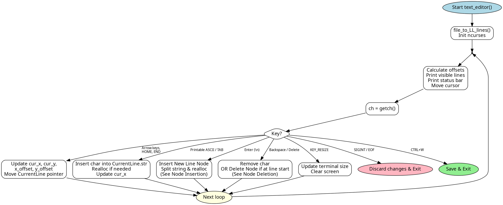
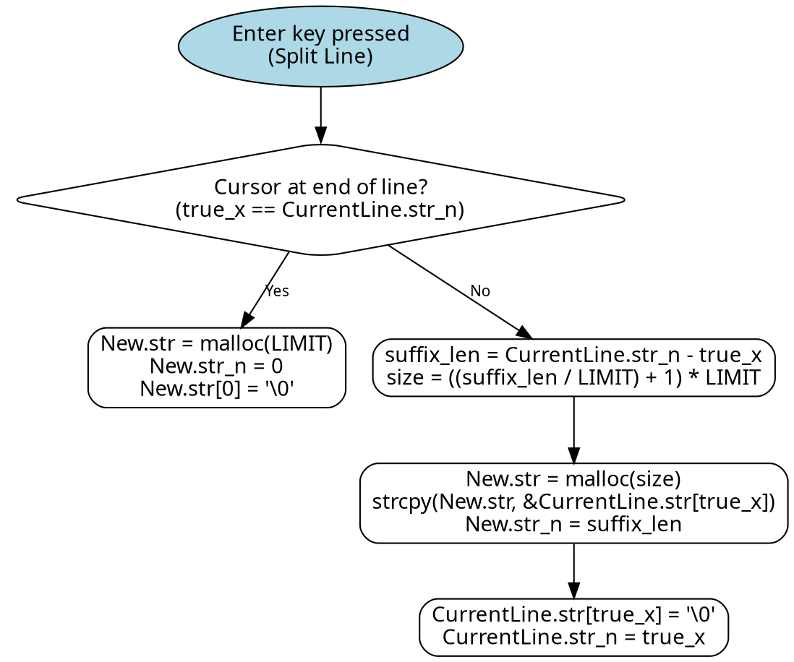
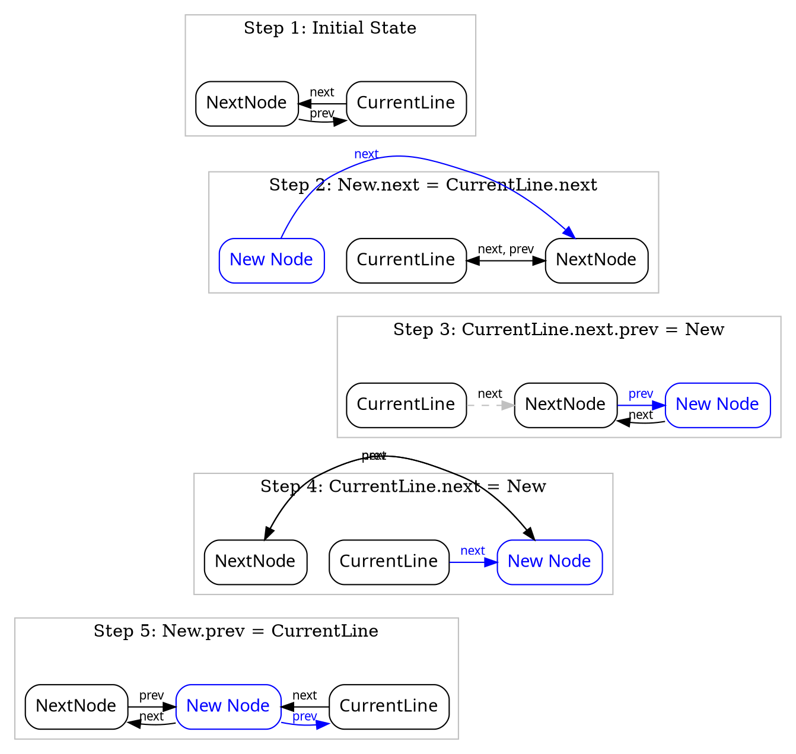
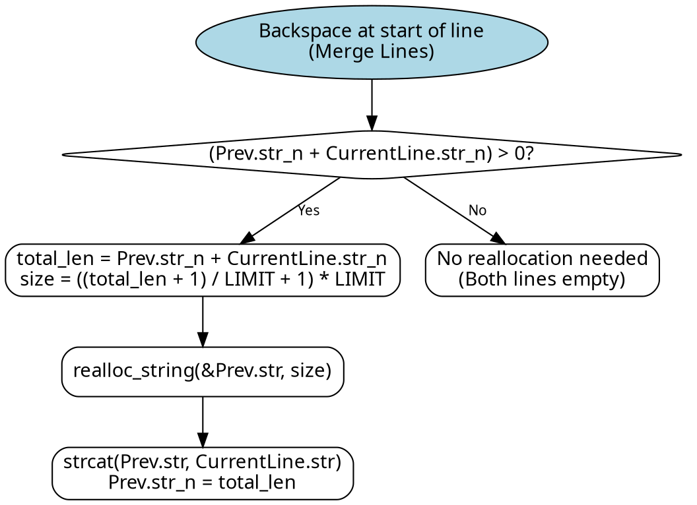
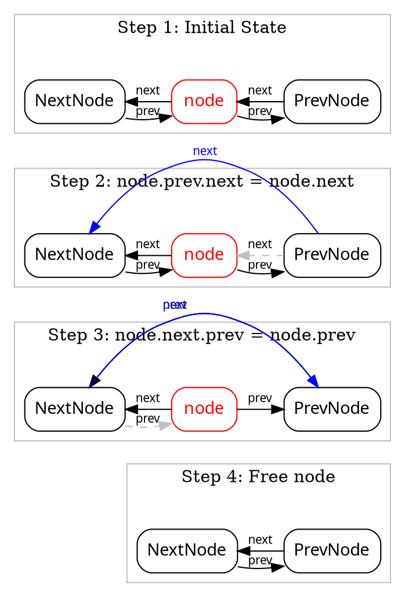

\page tui Text User Interfaces
We make use of the ncurses library to create TUIs, in contrast to our previous python project where we had to manually deal with ANSI escape keys.
\n This doesn't mean ncurses will abstract everything, it still requires knowledge of the terminal and how ncurses works.

The proper pattern is to use an init function (ncurses handles state externally, so we don't worry about scope), call `refresh()` every loop, and call `clear()` if doing anything that leaves characters in the terminal buffer (i.e. backspacing in text editor, the characters were never explicitly cleared)

\section windows_tui_design_caveats Setting the terminal to raw mode, and Windows quirks
**ncurses on Windows will not see CTRL+Key until you press another key, unless the render loop is non-blocking and has a timeout.**
\n non-blocking meaning will keep looping even though the user hasn't pressed a key.
\n in other words, `nodelay(1)` and `wtimeout(16)` makes `getch()` return `-1` when there is nothing in stdin


We wanted to have custom behaviour with CTRL+C such that it wouldnt outright quit the program, and instead cancel the current operation. 
\n This means we call `raw()` in \ref ncurses_init() so we get to handle CTRL+Key events ourselves.

Setting a terminal to raw mode/cbreak means that every single character is immediately sent to stdin, raw mode makes the terminal let characters through wihtout sending signals (e.g. SIGINT from CTRL+C)
\n In contrast to the default cooked mode, it only sends characters to stdin once you send newline (enter)

so the windows API equivalent to raw mode and noecho would be:

@code{.c}
DWORD mode;
GetConsoleMode(hin, &mode);
mode &= ~(ENABLE_LINE_INPUT | ENABLE_PROCESSED_INPUT | ENABLE_ECHO_INPUT);
SetConsoleMode(hin, mode);
@endcode


On Linux, when you press `CTRL+Q`, the PTY translates it to a single byte `0x11` and stuffs it in stdin. It's already there when ncurses calls read() on stdin
\n On Windows, input goes through the event queue of `ReadConsoleInput`(https://learn.microsoft.com/en-us/windows/console/readconsoleinput), which deal with `INPUT_RECORD` structs. keyboard events with flags for modifier keys (CTRL, SHIFT, ALT). ncurses on Windows has to:

-# Call ReadConsoleInput to consume the event queue
-# Check CTRL is held via the modifier flags
-# Manually compute the control character value (`key & 0x1F`)
-# Put the byte into its own internal buffer for getch() to return
\n ... which all take non-zero time to complete.

When the render loop is blocking or the timeout is 0, `getch()` will check its internal buffer and find nothing, because it doesn't have time at all to process the CTRL+key so the `INPUT_RECORD` is still sitting in Window's event queue, and `getch()` will still return `-1`. That is until you press another key and it suddenly comes through.

Also cmd and Powershell doesn't send `KEY_RESIZE` to the program, so we have to use the windows API and poll for the terminal size ourselves.
\n \ref check_console_window_resize_event()


\section simple_tui_design Simple TUI
\ref simple_select()
This section will explain things that will be skimmed through / abstracted in later sections.


\section cfg_editor Config editor
\ref config_editor is a function that provides a TUI for editing `key: value` or `key=value` files.
\n It shows and scrolls the keys on the left side, while showing the value on the right side. 
\n When pressing enter, the user can switch between EDIT mode and SELECT mode.
\n During EDIT mode, the user can use their keyboard to edit the value.


\image html config_editor.png "SELECT mode"
\image latex config_editor.png "SELECT mode"
\n \n
\image html config_editor_edit.png "EDIT mode, with blinking cursor"
\image latex config_editor_edit.png "EDIT mode, with blinking cursor"


Also you can pass a string array to prevent users from changing some fields

\image html config_editor_no.png ""
\image latex config_editor_no.png ""


\ref KEY_RESIZE is not handled after the first switch case, so it effectively restarts the loop and refreshes the menu

Flowchart for \ref config_editor
```dot
digraph ConfigEditor {
    rankdir=TB;
    node [shape=box, style=rounded, fontname="sans-serif"];
    edge [fontname="sans-serif", fontsize=10];

    Start [shape=ellipse, style=filled, fillcolor=lightblue, label="Start config_editor()"];
    InitNcurses [label="Initialize ncurses\n& clear screen"];
    LoopStart [shape=point];
    
    CheckEditMode [shape=diamond, label="edit_mode == 1?"];
    
    DrawEditMode [label="Draw EDIT MODE\nDraw edit_buffer in place of value\nMove cursor to value"];
    DrawSelectMode [label="Draw SELECT MODE\nDraw left_win (config keys)\nDraw right_win (values or warnings)"];
    
    GetCh [label="ch = getch()"];
    
    GlobalKeys [shape=diamond, label="Key?"];
    HandleResize [label="Get terminal size\n(KEY_RESIZE)"];
    HandleExit [shape=ellipse, style=filled, fillcolor=lightpink, label="Exit without saving\n(KEY_ETX, KEY_EOT)\nreturn -1"];
    
    CheckModeForKeys [shape=diamond, label="edit_mode == 1?"];
    
    // Edit Mode Keys
    EditKeySwitch [shape=diamond, label="Key?"];
    MoveCursor [label="Move Cursor\n(HOME, END, LEFT, RIGHT)"];
    ModifyBuffer [label="Modify Buffer\n(BACKSPACE, DEL, ASCII chars)"];
    ConfirmEdit [label="Save edit_buffer to config entry\nedit_mode = 0\n(Enter)"];
    
    // Select Mode Keys
    SelectKeySwitch [shape=diamond, label="Key?"];
    SaveAndExit [shape=ellipse, style=filled, fillcolor=lightgreen, label="Save config to file\nreturn 0\n(CTRL_W)"];
    ChangeSelection [label="Change Selection\n(UP, DOWN, LEFT, RIGHT)"];
    TryEdit [shape=diamond, label="Is key in disallow list?\n(Enter)"];
    EnterEditMode [label="edit_mode = 1\nCopy value to edit_buffer"];
    SetDisallowWarning [label="allow = 0\n(Show warning next loop)"];
    
    CleanupWins [label="Delete windows if they exist\n(left_win, right_win)"];

    // Flow
    Start -> InitNcurses -> LoopStart;
    LoopStart -> CheckEditMode;
    
    CheckEditMode -> DrawEditMode [label="Yes"];
    CheckEditMode -> DrawSelectMode [label="No"];
    
    DrawEditMode -> GetCh;
    DrawSelectMode -> GetCh;
    
    GetCh -> GlobalKeys;
    
    GlobalKeys -> HandleResize [label="KEY_RESIZE"];
    HandleResize -> CheckModeForKeys;
    
    GlobalKeys -> HandleExit [label="EOF / SIGINT"];
    
    GlobalKeys -> CheckModeForKeys [label="Other"];
    
    CheckModeForKeys -> EditKeySwitch [label="Yes"];
    CheckModeForKeys -> SelectKeySwitch [label="No"];
    
    EditKeySwitch -> MoveCursor [label="Nav Keys"];
    EditKeySwitch -> ModifyBuffer [label="Typing / Del"];
    EditKeySwitch -> ConfirmEdit [label="Enter"];
    EditKeySwitch -> CleanupWins [label="Other"];
    
    MoveCursor -> CleanupWins;
    ModifyBuffer -> CleanupWins;
    ConfirmEdit -> CleanupWins;
    
    SelectKeySwitch -> SaveAndExit [label="CTRL+W"];
    SelectKeySwitch -> ChangeSelection [label="Nav Keys"];
    SelectKeySwitch -> TryEdit [label="Enter"];
    SelectKeySwitch -> CleanupWins [label="Other"];
    
    ChangeSelection -> CleanupWins;
    
    TryEdit -> EnterEditMode [label="No"];
    TryEdit -> SetDisallowWarning [label="Yes"];
    
    EnterEditMode -> CleanupWins;
    SetDisallowWarning -> CleanupWins;
    
    CleanupWins -> LoopStart;
}

TODO: explain insert mode during edit mode
```

\section text_edit_design Text editor
We decided to write our own text editor to reduce the amount of dependencies HMS uses. 

We *could* just use nano, vim, or notepad, but those are extra dependencies and might break the "No GUI" requirement. 

It serves as a terminal pager (although it loads the entire file) and is a very primitive text editor. 

Like nano, the functions loads the file by parsing each line as a node in a doubly linked list, which made insertions much faster (O(1)) and more practical to write. If we stored the lines in a `char **` (array of string pointers), insertions and removals are O(n) and are more annoying to manage.

see:\n 
- \ref file_to_LL_lines()
- Further explanation of memory allocation in 
<!--TODO: fileparsing.md -->

- \ref text_editor()

Features: 
- readonly
- vertical and horizontal scrolling
- line numbers
- dynamic memory allocation
- splitting newlines

TODO: explanations of vertical and horizontal scrolling, and line number



When you press enter in a text editor, it creates a new line. Naively you'd just insert a `\n` in the string. 

In our case, we need to do node insertion, and manually allocate memory when splitting a line. When a line is split between the cursor, the memory size of the previous line is the length the prefix, while the next line is the length of the suffix.





Inversely, removing a line would just be removing a `\n`

When backspacing at the start of the line, The current line is concatenated to the previous line, then the current line is deleted. 
\n We need to do node deletion, and calculate the new size.





TODO: explain why the new size is the next multiple of threshold
